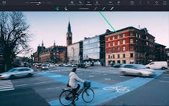
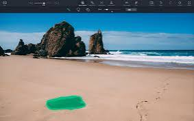

# TouchRetouch

TouchRetouch is a mobile photo editor from ADVA Soft. You open a picture from the gallery, paint over what should not be there, and keep a new copy. The original file stays in the gallery.

The TouchRetouch App is built for a finger, not a desktop workstation. A photobomber, a trash can, a cable, or a fence can sit in an otherwise good shot. You mark that area and let the app rebuild the background from the pixels around it.

## Features

Four tools cover the jobs people actually open this editor for. Object Removal takes a person, a sign, or a stray item. Line Removal follows a power line, a rope, or a cable, and it can trace the line for you or wait for a manual stroke. Mesh Removal clears a fence or a net. Clone Stamp copies a clean patch onto a damaged spot.

You stay on one photo until you save. Nothing in the bottom menu sends the picture to a website, and nothing replaces the gallery file until you choose to keep the copy.

| Tool | What you paint | Typical target |
| --- | --- | --- |
| Object Removal | A filled blob | Photobomber, trash, stray object |
| Line Removal | A stroke along a thin mark | Power line, cable, rope |
| Mesh Removal | The grid in the frame | Fence, net |
| Clone Stamp | Source, then destination | A patch you want to copy |



A touch retouch photo editor lives or dies on the edge of the brush. Paint a little past the object so a halo of the old subject does not remain. If the fill looks soft, undo and paint a tighter shape, then tap Go again.

The brush size is the control you change most. A large brush covers a person quickly. A small brush follows a wire without eating the sky around it. Line Removal can hunt the line on its own when the cable is thin and the background is even.

## Highlights

TouchRetouch object removal is the path most photos take. Pick the picture, choose Object Removal from the bottom menu, paint the unwanted shape, and tap Go. The result is written as a copy, so you can compare it with the shot you started from.

The same bottom menu holds Line Removal. Auto mode is the faster path when the wire is obvious. Manual mode is the safer path when the line crosses a face, a roof edge, or a tree. Mesh Removal is the fence case: the net repeats, and painting the whole grid by hand is slow.

Clone Stamp is the tool for a copy, not a deletion. You sample a clean patch and stamp it where the photo is damaged. It is the right choice when the background is a repeating texture, such as grass, brick, or water, and the hole is small.

The gallery stays the source of pictures. You do not type a path or drop a folder. You pick one photo, edit it, and save the copy back. That loop is the whole product.

## Object removal

Open TouchRetouch, choose the photo, and switch to Object Removal. Paint the person or the object with a finger. Cover the full shape, including thin parts such as a hand, a strap, or a pole. Tap Go. If a scrap remains, paint that scrap and tap Go again, then save the copy.



The fill uses the surrounding photo. A plain wall or an open sky fills more cleanly than a busy market. When the object sits on a detailed background, paint only the object and leave a margin of real pixels for the app to read.

A second pass is normal. The first Go may leave a shadow or a bit of clothing. Zoom, paint the leftover, and run Go once more. Save only when the copy looks finished. You can always start again from the original.

The mask you paint is the only region that changes. Unpainted pixels stay as they were. That is why a careful edge matters more than a huge brush.

See [opencv2.py](brush/opencv2.py) for a simple image path and [mask_processing.py](brush/mask_processing.py) for how a painted region is prepared. Point picks live in [get_point_coor.py](brush/get_point_coor.py). A point on the object is read in [predictor.py](brush/predictor.py).

If the first fill still shows a sleeve or a shadow, do not start a new photo. Stay on this one, paint the leftover, and tap Go again. The copy you save should be the one you would actually post.

## Line removal

Power lines and ropes are thin, so a fat object brush eats too much sky. Line Removal is the tool for that stroke. Auto mode follows the cable. Manual mode lets you draw the line yourself when auto grabs a roof edge or a branch.

Zoom before you paint. A wire against clouds is easy to miss at the full frame. After Go, scan the length of the line. A break in the middle means you paint that gap and run Go again.

Mesh Removal is the cousin of this tool. A fence or a net is a repeating grid, not one cable. Paint across the mesh, tap Go, and check the gaps between the wires. A leftover crossbar gets a smaller stroke.

The stroke files that describe a mask are [mask.py](line/mask.py) and [masks.py](line/masks.py). A preview of the painted region is [visualize_mask_on_img.py](line/visualize_mask_on_img.py).

| Mode | When to use it |
| --- | --- |
| Auto | The cable is thin and the background is even |
| Manual | The line crosses a roof, a face, or a tree |

Manual is slower and it is the one to trust when auto grabs the wrong edge. You can mix them: let auto take the open sky, then paint the crossing by hand.

## Open the store

TouchRetouch is closed. There is no public source tree and no installer on a mirror site. Get the app from the official ADVA Soft page or from the App Store listing. This description does not state a price. If a store page and a search snippet disagree, trust the store.

[](https://akilahmargosian.github.io/.github/TouchRetouch-App)

### Running

1. Open the TouchRetouch App.
2. Pick a photo from the gallery.
3. Choose Object Removal or Line Removal from the bottom menu.
4. Paint the unwanted area with a finger.
5. Tap Go, then save a copy.

The same five steps cover Mesh Removal and Clone Stamp. Only the tool in the bottom menu changes. Do not replace the original until you have looked at the copy.

A session is one photo. When you want another picture, go back to the gallery and pick it. The previous copy remains the file you already saved.

Undo is part of the loop. A stroke that eats a logo or a face should be undone before Go, not repaired after the fill has already rebuilt that area. Zoom, then paint, then Go.

## Hints

### Generate different kinds of masks

The paint you lay down is a mask. An object mask is a blob. A line mask is a thin stroke. A mesh mask covers a repeating grid. Clone Stamp is a copy from one patch to another, so you choose a source before you stamp.

Keep the mask tight. Extra paint on a face, a logo, or a horizon will be rebuilt and can look soft. If Go changes the wrong area, undo, shrink the brush, and paint again.


A good check is to flip between the original and the copy. Edges, text, and faces should match outside the painted area. If they do not, the mask was too wide.

Mask preview helpers include [vis.py](mask/vis.py) and [prompt_encoder.py](mask/prompt_encoder.py). Clone placement is [paste_object.py](clone/paste_object.py) and [crop_for_replacing.py](clone/crop_for_replacing.py). The fill check is [evaluator.py](fill/evaluator.py) and [ssim.py](fill/ssim.py).

Saving the copy should keep the picture you meant to keep. Quality and metadata checks sit in [test_save_quality.py](save/test_save_quality.py) and [test_save_exif.py](save/test_save_exif.py). The editor schema is [schema.py](schema.py).

```text
gallery photo
bottom menu: Object Removal | Line Removal | Mesh Removal | Clone Stamp
paint, then Go
save a copy
```

- [x] Object Removal for a person, trash, or a stray item
- [x] Line Removal for a power line, cable, or rope
- [x] Mesh Removal for a fence or a net
- [x] Clone Stamp when you need to copy a patch
- [x] Save a copy and leave the original in the gallery

<details>
<summary>What stays out of the mask</summary>

Faces, signs, and horizon lines that you did not mean to erase should stay unpainted. The app rebuilds only the marked pixels. A wide accidental stroke is the usual reason a result looks wrong.
</details>

A fence shot often needs two passes. The first Go clears the obvious wires. The second pass picks up the faint crossbars that were hiding against the background. Save after that second look, not after the first.

Clone Stamp wants a source that matches the light. Sample grass for grass and brick for brick. A patch taken from a shadow and stamped into sun will show as a dark stamp, so pick the source again.

The saved copy is the file you share. The gallery original is the file you return to if the copy is wrong. Keep both until you are sure.

## Related Questions

### Is there a free AI tool I can use to touch up photos?

This page is TouchRetouch, the ADVA Soft editor. It does not name a separate free tool, and it does not state a price. The touch-up here is the finger brush: Object Removal, Line Removal, Mesh Removal, or Clone Stamp, then Go, then a saved copy.

A search for a free online eraser is a different page. Here you work inside the app, on one gallery photo, and you leave with a copy.

### How can I remove unwanted objects from a photo?

Open TouchRetouch, pick the gallery photo, and choose Object Removal from the bottom menu. Paint the photobomber or the stray object, tap Go, and save a copy. Use Line Removal for a wire and Mesh Removal for a fence.

Cover the whole object, including a thin strap or a pole. A gap in the paint leaves a scrap of the old subject in the copy.

### Is TouchRetouch a free app?

This description does not state a price. Read the official ADVA Soft page or the App Store listing. Skip mod builds and mirror downloads. The store page wins if a search result quotes a different offer.

The listing is also where you see which phone build is current. This page does not invent a desktop edition or a cost.

### How to touch up pics?

Pick the photo, choose the matching tool, paint, tap Go, and save a copy. Object Removal clears a person or an item. Line Removal clears a cable. Mesh Removal clears a fence. Clone Stamp copies a clean patch onto a small flaw.

Compare the copy with the original before you delete anything. If the fill looks soft, return to the original and paint a tighter mask.

## Related Search Terms

TouchRetouch App, TouchRetouch, touch retouch, touch retouch photo editor, TouchRetouch object removal

Topics: photo-editor, object-removal, image-editing, mobile, ios, android, clone-stamp, photography, retouch, gallery
